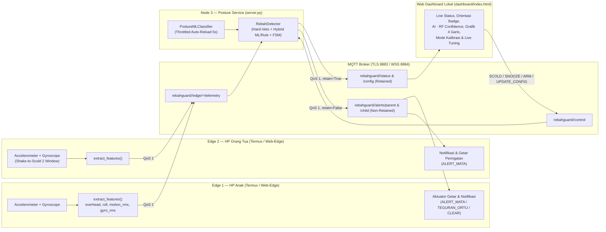

# RebahGuard: Sistem Pencegah Kebiasaan Main HP Sambil Rebahan Berbasis Multisensor, Hybrid ML & MQTT Dua Arah

**RebahGuard** adalah sistem IoT *eye-care* dan pemantau postur penggunaan smartphone secara real-time menggunakan fusi sensor **Accelerometer** dan **Gyroscope**, arsitektur **Hybrid Machine Learning (Random Forest) + Finite State Machine (FSM)**, serta komunikasi **MQTT Dua Arah (QoS 1, TLS/WSS)**.

---

## 1. Masalah & Solusi RebahGuard

Kebiasaan menggunakan HP sambil rebahan (telentang dengan layar menghadap ke bawah di atas wajah atau menunduk ekstrem dalam waktu lama) meningkatkan kelelahan mata (*asthenopia*), risiko jatuh HP ke wajah, dan gangguan postur leher. Tantangan utama deteksi postur berbasis IMU smartphone adalah:
1. **Ambiguitas HP Telungkup di Meja vs Rebahan Telentang**: Keduanya memiliki sudut kemiringan `overhead_deg > 110°` hingga `180°`.
2. **Bias Kalibrasi Akselerometer MEMS**: Sensor smartphone komersial memiliki *zero-g offset* statis ($0.1\text{--}0.3\text{ m/s}^2$) sehingga pengurangan langsung terhadap $9.81\text{ m/s}^2$ memicu positif palsu saat HP diam di meja.
3. **Orientasi Landscape (Main Game / Menonton) vs Portrait**: Cara memegang HP saat duduk bermain game *landscape* memiliki kemiringan sumbu yang berbeda dari *portrait*.

**Solusi RebahGuard**:
- **3 Tahap Pengolahan Sinyal (`shared/processing.py`)**: *Gravity Orientation Smoothing* (`overhead_deg`, `roll_deg`, `lean_deg`), *Mean-Centered Dynamic Motion RMS* (`motion_rms` bebas bias gravitasi), dan *Gyroscope Micro-Activity RMS* (`gyro_rms`).
- **Deteksi Orientasi Otomatis (`PORTRAIT` / `LANDSCAPE`)**: Menggunakan *in-plane lean angle* dengan *flat-gate* (`flat_gate_deg = 20°`) dan *debounce* waktu (`orientation_confirm_sec = 0.5s`) agar threshold menyesuaikan mode pemakaian layar.
- **Arsitektur Hybrid ML + FSM dengan Hard-Veto Fisik**: Menggabungkan **Random Forest Classifier** (5 fitur: `overhead_deg`, `roll_deg`, `lean_deg`, `motion_rms`, `gyro_rms`) + **Temporal Majority Smoothing** dengan pengaman fisik (*hard-veto* meja telungkup dan fallback histeresis sudut matematis).

---

## 2. Arsitektur Sistem 2 Arah



---

## 3. Panduan Cepat Menjalankan Sistem

### A. Persiapan Environment
```bash
python -m pip install -r requirements.txt
cp .env.example .env
# Ubah PROJECT_ID di .env dengan nama unik kelompok Anda
```

### B. Menjalankan Server & Dashboard Lokal
```bash
python server.py
```
Server akan menjalankan `posture_service` sekaligus membuka Web Dashboard lokal di browser (`http://127.0.0.1:8000`).

### C. Menjalankan Node Edge (HP Anak & HP Orang Tua)
- **Opsi 1 — Browser HTTPS (`web-edge/index.html`)**: Buka halaman Web-Edge melalui HTTPS di browser HP Anak (`edge1`) dan HP Orang Tua (`edge2`), masukkan `PROJECT_ID`, lalu ketuk **Mulai Sensor & Kirim Telemetry**.
- **Opsi 2 — Android Termux (`hp_anak.py` & `hp_ortu.py`)**:
  ```bash
  python hp_anak.py --source android
  python hp_ortu.py --source android
  ```
- **Opsi 3 — Demo Simulator Tanpa Sensor Fisik**:
  ```bash
  python -m scripts.offline_demo
  ```

---

## 4. Pipeline Machine Learning: Perekaman Multi-Sesi & Pelatihan Bebas Data Leakage

RebahGuard menyediakan pipeline pembelajaran mesin end-to-end yang membingkai ML sebagai **data-driven threshold & posture learning** yang dapat dikalibrasi ulang per pengguna, sekaligus dievaluasi berdampingan (*head-to-head benchmark*) terhadap **Rule-Based Baseline** pada *test set* sesi yang sama.

### Langkah 1: Rekam Dataset Multi-Sesi (Minimal 3 Sesi per Kelas = Total 9 Sesi)
Untuk mencegah *temporal autocorrelation / data leakage* antara data latih dan data uji, rekam **minimal 3 sesi terpisah untuk setiap kelas** (masing-masing memakai `session_id` unik otomatis) dengan variasi sub-postur nyata:

1. **Kelas `POSISI_DUDUK_SEHAT` (Minimal 3 Sesi)**:
   - Sesi 1: Duduk tegak memegang HP dalam orientasi **portrait** (`--samples 40`).
   - Sesi 2: Duduk tegak bermain game / menonton dalam orientasi **landscape** (`--samples 40`).
   - Sesi 3: HP diletakkan **tergeletak menghadap atas di meja** (*flat face-up*, `overhead_deg ~ 0°`) atau dipegang agak rendah di pangkuan (`--samples 40`).
   ```bash
   python -m scripts.collect_dataset --label POSISI_DUDUK_SEHAT --samples 40
   ```

2. **Kelas `DITARUH_TELUNGKUP` (Minimal 3 Sesi)**:
   - Sesi 1–3: HP diletakkan **telungkup diam di permukaan meja** (`overhead_deg ~ 175°–180°`, `motion_rms ~ 0`, `gyro_rms ~ 0`) pada beberapa posisi meja yang berbeda (`--samples 40` per sesi).
   ```bash
   python -m scripts.collect_dataset --label DITARUH_TELUNGKUP --samples 40
   ```

3. **Kelas `REBAHAN_AKTIF` (Minimal 3 Sesi)**:
   - Sesi 1: Rebahan telentang memegang HP di atas wajah dalam orientasi **portrait** (`overhead_deg >= 115°`, `--samples 40`).
   - Sesi 2: Rebahan sambil memegang HP dalam orientasi **landscape** (`overhead_deg >= 85°`, `--samples 40`).
   - Sesi 3: Rebahan miring / menunduk ekstrem sambil menggerakkan jempol di layar (`--samples 40`).
   ```bash
   python -m scripts.collect_dataset --label REBAHAN_AKTIF --samples 40
   ```

> **Keamanan Perekaman**: `scripts/collect_dataset.py` menerapkan filter **anti-stale** (`30s`), **anti-replay** (`(device_id, boot_id, sequence)`), dan hanya menerima `device_id == "edge1"`.

### Langkah 2: Latih Model & Evaluasi Benchmark (`scripts/train_model.py`)
```bash
python -m scripts.train_model --input data/posture_dataset.csv
```
Skrip pelatihan akan:
- Memvalidasi setiap kelas memiliki $\ge 30$ sampel dan $\ge 2$ `session_id` unik.
- Melakukan **Group Split per `session_id`** sehingga `Session Overlap (Train ∩ Test): 0 sesi`.
- Melatih `RandomForestClassifier` dan mencetak perbandingan **Accuracy**, **Macro F1-Score**, **Confusion Matrix 3x3**, serta **Feature Importance** antara **Random Forest (ML)** vs **Rule-Based Baseline**.
- Menyimpan model ke `models/posture_rf.joblib` (otomatis dimuat oleh `posture_service` tanpa restart berkat *throttled auto-reload* 5 detik) dan metrik ke `models/metrics.json`.

---

## 5. Catatan Keterbatasan Ilmiah Sensor IMU

Secara fisika, sensor **Accelerometer** dan **Gyroscope** pada smartphone hanya mengukur vektor gravitasi bumi dan kecepatan sudut pada kerangka koordinat perangkat HP, **bukan membaca anatomi atau posisi tulang belakang pengguna secara langsung**:
- Label `REBAHAN_AKTIF` merepresentasikan kombinasi sudut kemiringan layar menghadap ke bawah (`overhead_deg`), kemiringan sumbu layar (`roll_deg` & `lean_deg`), serta mikro-aktivitas tangan pengguna (`motion_rms` & `gyro_rms`).
- Oleh karena itu, RebahGuard memadukan **Hard-Veto Fisik** (saat HP telungkup diam di meja, `DITARUH_TELUNGKUP` selalu menang mutlak atas prediksi ML), **Temporal Majority Smoothing** (`ml_smoothing_window = 3`), dan **Live Parameter Tuning** di Dashboard agar sistem tetap andal dan bebas positif palsu.

---

## 6. Menjalankan Pengujian Otomatis (Unit Tests)
```bash
python -m unittest discover -s tests -v
```

